Build shapes from signed distance fields, combine them with booleans and smooth unions, and export the result as TypeGPU, WGSL or GLSL.

**[Open d-stance](https://collectioneur.github.io/d-stance/)** - needs a WebGPU browser: Chrome or Edge 113+.

The whole scene lives in the URL, so to save or share a project just copy the link.

## Run locally

```bash
npm install
npm run dev
```
