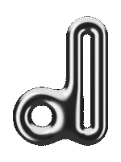

```aura width=800 height=216
<div style={{ display: 'flex', position: 'relative', width: '100%', height: '100%', background: '#0b0b0b', border: '1px solid #1f1f1f', borderRadius: 20, overflow: 'hidden', fontFamily: 'Inter, sans-serif' }}>
  <svg width="800" height="216" style={{ position: 'absolute', top: 0, left: 0 }}>
    <defs>
      <radialGradient id="spot" cx="50%" cy="50%" r="50%">
        <stop offset="0%" stopColor="#ffffff" stopOpacity="0.11" />
        <stop offset="100%" stopColor="#ffffff" stopOpacity="0" />
      </radialGradient>
      <radialGradient id="shadow" cx="50%" cy="50%" r="50%">
        <stop offset="0%" stopColor="#000000" stopOpacity="0.75" />
        <stop offset="100%" stopColor="#000000" stopOpacity="0" />
      </radialGradient>
      <linearGradient id="axisX" x1="0" y1="0" x2="1" y2="0">
        <stop offset="0%" stopColor="#d94c4c" stopOpacity="0" />
        <stop offset="70%" stopColor="#d94c4c" stopOpacity="0.7" />
        <stop offset="100%" stopColor="#d94c4c" stopOpacity="0" />
      </linearGradient>
      <linearGradient id="axisZ" x1="0" y1="0" x2="0" y2="1">
        <stop offset="0%" stopColor="#5a85e6" stopOpacity="0" />
        <stop offset="100%" stopColor="#5a85e6" stopOpacity="0.8" />
      </linearGradient>
      <linearGradient id="horizon" x1="0" y1="0" x2="0" y2="1">
        <stop offset="0%" stopColor="#0b0b0b" stopOpacity="1" />
        <stop offset="100%" stopColor="#0b0b0b" stopOpacity="0" />
      </linearGradient>
      <linearGradient id="textSide" x1="0" y1="0" x2="1" y2="0">
        <stop offset="0%" stopColor="#0b0b0b" stopOpacity="0.9" />
        <stop offset="100%" stopColor="#0b0b0b" stopOpacity="0" />
      </linearGradient>
    </defs>
    <ellipse cx="560" cy="100" rx="170" ry="120" fill="url(#spot)" />
    {/* Floor y = 115 + 81 / z, vanishing point under the letter (x = 560). */}
    {Array.from({ length: 41 }, (_, i) => (i - 20) * 0.5).map((x) => (
      <line x1={560 + (81 * x) / 0.8} y1="216" x2={560 + (81 * x) / 14} y2={115 + 81 / 14} stroke="#ffffff" strokeOpacity="0.06" strokeWidth="1" />
    ))}
    {Array.from({ length: 27 }, (_, k) => 0.8 + 0.5 * k).map((z, k) => (
      <line x1="0" x2="800" y1={115 + 81 / z} y2={115 + 81 / z} stroke="#ffffff" strokeOpacity="0.06" strokeWidth="1">
        <animate attributeName="stroke-opacity" values="0.06;0.06;0.2;0.06" keyTimes="0;0.6;0.8;1" dur="5s" begin={`${-k * 0.12}s`} repeatCount="indefinite" />
      </line>
    ))}
    <line x1="560" y1="121" x2="560" y2="216" stroke="url(#axisZ)" strokeWidth="1.2" />
    <line x1="80" y1="169" x2="800" y2="169" stroke="url(#axisX)" strokeWidth="1.2" />
    <rect x="0" y="115" width="800" height="48" fill="url(#horizon)" />
    <rect x="0" y="0" width="460" height="216" fill="url(#textSide)" />
    <ellipse cx="560" cy="170" rx="50" ry="8" fill="url(#shadow)" />
  </svg>
  
  <div style={{ display: 'flex', flexDirection: 'column', position: 'absolute', left: 48, top: 50 }}>
    <div style={{ fontSize: 40, fontWeight: 700, color: '#f2f2f2', letterSpacing: -1.2 }}>d-stance</div>
    <div style={{ fontSize: 16, color: '#8a8a8a', marginTop: 6 }}>3D SDF editor in the browser</div>
    <div style={{ display: 'flex', marginTop: 16 }}>
      {['WebGPU', 'TypeGPU', 'React'].map((t) => (
        <div style={{ display: 'flex', fontSize: 12, color: '#bdbdbd', padding: '5px 11px', marginRight: 7, border: '1px solid #2a2a2a', borderRadius: 999, background: '#141414' }}>{t}</div>
      ))}
    </div>
  </div>
</div>
```

Build shapes from signed distance fields, combine them with booleans and smooth unions, and export the result as TypeGPU, WGSL or GLSL.

```bash
npm install
npm run dev
```

Needs a WebGPU browser: Chrome or Edge 113+.
